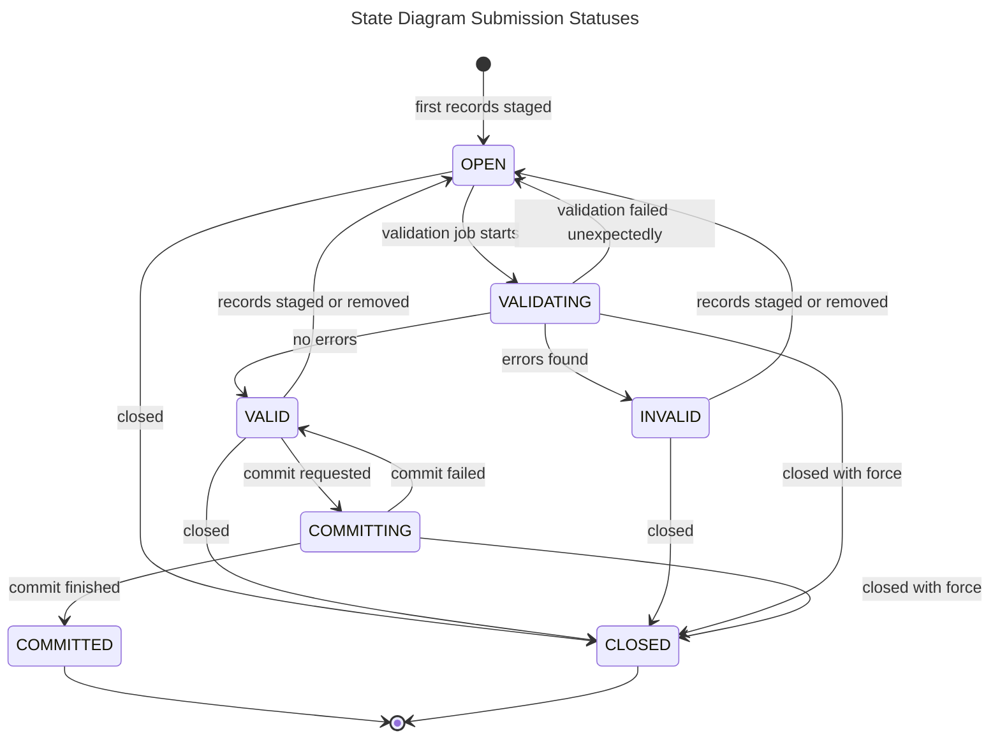

| Status | Meaning | Records can be staged or removed |
| --- | --- | --- |
| `OPEN` | Created, or its records changed since the last validation. Waiting for a validation job. | yes |
| `VALIDATING` | A validation job is checking its records. | no |
| `VALID` | The last validation found no errors. It can be committed. | yes |
| `INVALID` | The last validation found errors. | yes |
| `COMMITTING` | Its records are being written to Submitted Data. | no |
| `COMMITTED` | Its records are in Submitted Data. | no |
| `CLOSED` | Discarded without being committed. | no |

How the transitions work:

- **Every change to the records sets the status to `OPEN`** and increments the Submission `version`, then queues a validation job for that version.
- **A validation job only starts if the Submission is `OPEN` and still at the job's version.** A job queued before a later change does nothing, and the job for the latest version validates the records.
- **A validation result is only saved if the Submission is still `VALIDATING` at the same version.** Otherwise the result is discarded.
- **A commit only starts if the Submission is `VALID`, every record is `VALID`, and its version hasn't changed** since the commit was requested.
- **A failed commit sets the status back to `VALID`**, so the commit can be requested again.
- **`DELETE /submission/{submissionId}` closes a Submission that is `OPEN`, `VALID` or `INVALID`.** With `force=true` it closes a Submission in any status. That includes `VALIDATING` and `COMMITTING`, as drawn above, and also `COMMITTED` and `CLOSED`.

For the full validation process, see [Submission validation](../../data-provider/docs/submission-validation.md). For the commit, see the [commit workflow](./submissionCommit.md).
